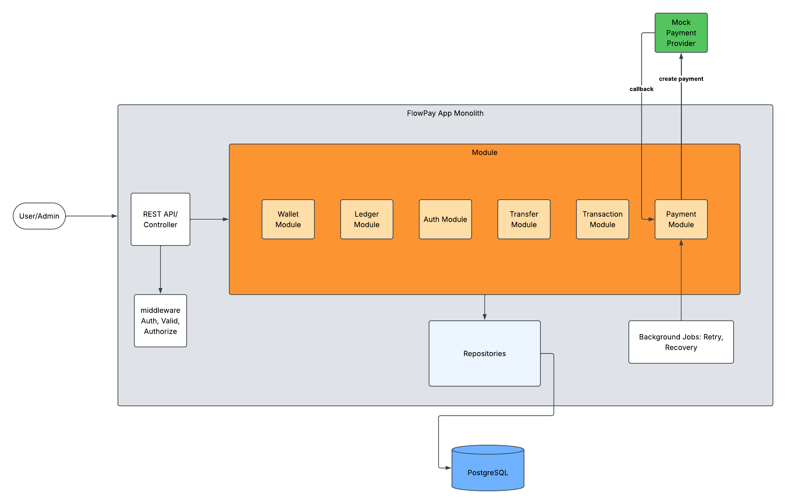
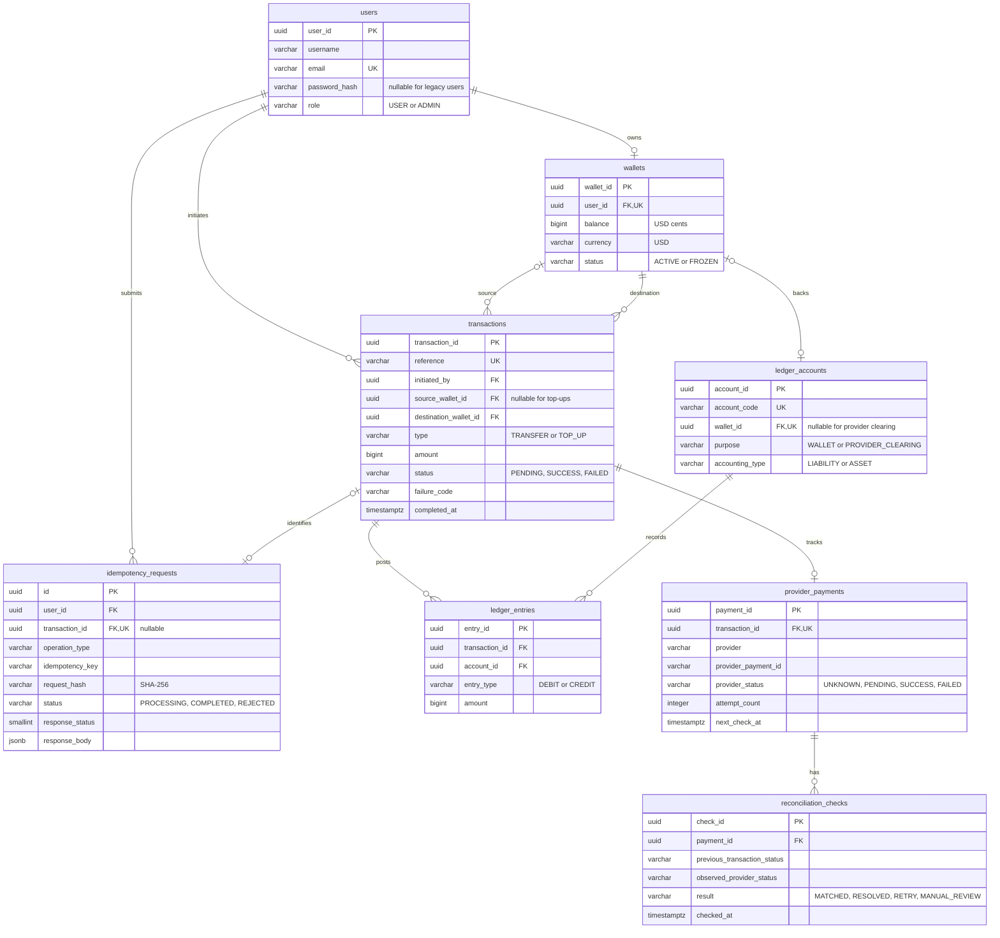

# FlowPay Backend

## Project Overview

FlowPay is a digital wallet backend for managing USD balances, transferring money between users, and maintaining an auditable financial history. It addresses common payment challenges: concurrent balance updates, duplicate requests after network timeouts, and partial writes that could leave balances and accounting records inconsistent.

The goal is to make money movement atomic, safe to retry, and traceable. Users can register, authenticate, create a wallet, fund it through the simulated provider, transfer money, and retrieve transaction results and history.

## Key Features

- **Stateless authentication:** BCrypt password hashing and HS256 JWT access tokens, with signature, issuer, audience, time, subject, and role validation. Wallet ownership comes from the verified token.
- **Wallet management:** one USD wallet per user, created with a zero balance and a corresponding liability ledger account in one database transaction.
- **Atomic internal transfers:** balance changes, transaction state, two ledger entries, and the idempotency result commit together within a single database transaction.
- **Concurrency control:** pessimistic wallet locks protect balances during competing transfers. Locks are acquired in a consistent UUID order to reduce the risk of deadlocks. Balance and overflow checks prevent overdrafts and invalid credits.
- **Persistent idempotency:** PostgreSQL uniqueness constraints, row locks, SHA-256 request fingerprints, and stored responses prevent duplicate execution. If client reuse a key with different business fields returns `409 IDEMPOTENCY_KEY_CONFLICT`.
- **Double-entry accounting:** each successful transfer debits the sender's liability account and credits the recipient's liability account by the same amount. The system does not allow updates or deletions of ledger entries.
- **Transfer queries:** lookup by reference or idempotency key, plus paginated history. Senders can see their failed transfers; recipients can see successful incoming transfers.
- **Asynchronous top-ups:** durable payment dispatch, HTTP provider integration, authenticated callbacks, and polling recovery. Confirmed payments credit wallets exactly once with balanced ledger entries. See [Top-up API and recovery](docs/top-up-api.md).
- **API tooling and verification:** OpenAPI/Swagger UI, structured Problem Detail errors, Actuator health checks, and PostgreSQL integration tests through Testcontainers.

## System Architecture

FlowPay is a **modular monolith**: a single Spring Boot application organized by business capability, backed by PostgreSQL.

- **API and security:** REST controllers expose user and admin endpoints. Spring Security authenticates and authorizes requests; Bean Validation checks request payloads.
- **Business modules:** auth, wallet, transfer, top-up, transaction, ledger, and payment services enforce business rules. Internal transfers commit balance changes, ledger entries, transaction state, and idempotency results in one database transaction.
- **Persistence:** JPA repositories store business data in the `flowpay` schema. Flyway manages schema migrations, and the mock provider uses Spring JDBC with a separate `mock_provider` schema in the same PostgreSQL database.
- **Payment processing:** background jobs dispatch pending payments and recover uncertain outcomes through retries and polling. Provider callbacks and polling share the same settlement service to credit confirmed top-ups exactly once.

The diagram shows the mock provider as a separate integration boundary. In the local simulation, it runs inside the same application under the `mock-provider` profile and communicates with the payment module over HTTP.

Registration and login are public endpoints; wallet, transfer, and top-up endpoints require a bearer token. The `mock-provider` profile enables the simulated provider, HTTP adapter, payment worker, and callback delivery. Provider requests use `X-Provider-Key`; callbacks use a separate `X-Callback-Key`. Their controllers verify these keys independently of user JWTs.

## Database Design

PostgreSQL contains eight business tables in the `flowpay` schema and a separate `mock_provider.payments` table. Flyway stores migration history in `public.flyway_schema_history`. The [SQL migrations](src/main/resources/db/migration) define the authoritative schema.

### Entity Relationship Diagram

The diagram shows the business tables and selected columns. Optional relationships reflect nullable foreign keys or unique constraints. Stronger guarantees, such as creating a wallet and its ledger account together, are enforced by services.

### Relationships and Integrity Rules

| Relationship or rule | Enforcement |
|---|---|
| User to wallet | `wallets.user_id` is a foreign key and unique: a user can have at most one wallet. |
| Wallet to ledger account | `ledger_accounts.wallet_id` is unique when present. Wallet accounts are liabilities; provider-clearing accounts have no wallet and are assets. |
| Transaction to wallets | Transfers require two distinct wallets. Top-ups require a destination wallet and a null source. |
| Transaction to ledger entries | Each entry references a transaction and an account. `(transaction_id, account_id, entry_type)` is unique. Successful transfers create two equal postings in the service transaction. |
| Transaction to provider payment | `provider_payments.transaction_id` is unique. External payment IDs are unique within each provider. |
| Request to transaction | A request may reference one transaction; a transaction can belong to at most one idempotency request. Pre-transaction rejections may have no transaction. |
| Provider payment to reconciliation checks | One payment can have many historical observations, recovery results, or manual-review conditions. |

Additional safeguards:

- `BIGINT` amounts must be positive; wallet balances must be nonnegative. Currency is constrained to `USD`.
- Foreign keys use `ON DELETE RESTRICT` to preserve referenced financial records.
- Transaction status and `completed_at` must agree: pending transactions have no completion timestamp; final transactions require one.
- Final idempotency records require an HTTP status and JSONB response. Completed requests also require a transaction reference.
- Emails are unique and lowercase. Legacy users without a password hash cannot log in.
- Ledger entries reject `UPDATE` and `DELETE` through the V4 trigger. Future corrections should use compensating transactions.
- Timestamps use `timestamptz`; the application supplies and maintains `updated_at` columns.

Balanced postings and coordinated balance changes are enforced by service transactions, rather than a database constraint spanning multiple rows.

### Indexing Strategy

Primary keys and unique constraints create indexes for ID lookups and duplicate prevention. Key unique indexes cover email, wallet ownership, transaction reference, ledger account code and wallet, provider external payment identity, ledger posting identity, and the idempotency scope.

The schema also defines these query indexes:

| Index | Columns | Purpose |
|---|---|---|
| `idx_transactions_source_history` | `(source_wallet_id, created_at DESC, transaction_id DESC)` | Outgoing wallet history |
| `idx_transactions_destination_history` | `(destination_wallet_id, created_at DESC, transaction_id DESC)` | Incoming wallet history |
| `idx_transactions_initiator_history` | `(initiated_by, created_at DESC)` | Initiator history, including failed transfers |
| `idx_ledger_entries_account_history` | `(account_id, created_at, entry_id)` | Account posting history with a stable ordering key |
| `idx_provider_payments_next_check` | `(next_check_at) WHERE next_check_at IS NOT NULL` | Durable dispatch and polling recovery |
| `idx_reconciliation_checks_payment_history` | `(payment_id, checked_at DESC)` | Latest reconciliation checks for a payment |

`mock_provider.payments` stores a payment UUID, unique provider payment ID, amount, currency, status, timestamps, and durable callback delivery state. It has no foreign key to the business schema; its payment UUID matches `flowpay.provider_payments.payment_id`. The mock components require the `mock-provider` profile. A seeded provider-clearing asset account balances wallet top-ups.

### Schema Migrations

| Version | Change |
|---|---|
| V1 | Create the `flowpay` schema |
| V2 | Create the eight business tables, constraints, and query indexes |
| V3 | Add `users.password_hash` |
| V4 | Protect ledger entries with an append-only trigger |
| V5 | Remove `provider_request_id`; use `payment_id` as the provider request reference |
| V6 | Create the `mock_provider` schema and payments table |
| V7 | Seed the provider-clearing account and add durable callback delivery state |

Flyway runs migrations before Hibernate validates the entities (`ddl-auto: validate`). Add a new migration for schema changes instead of editing one already applied.

